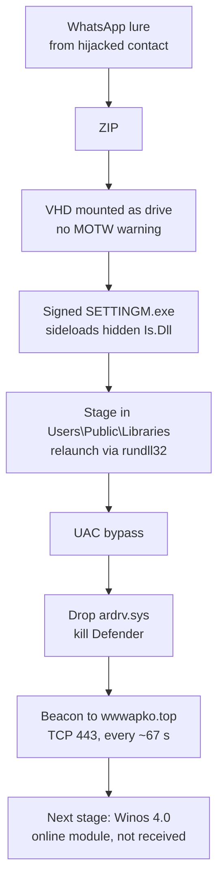
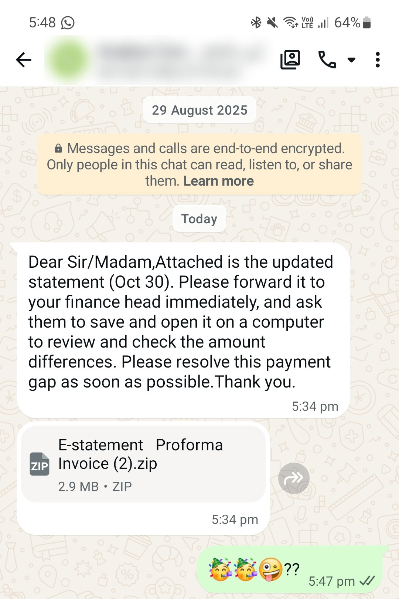
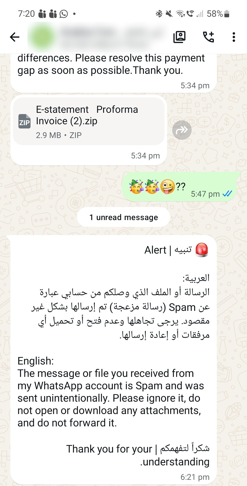
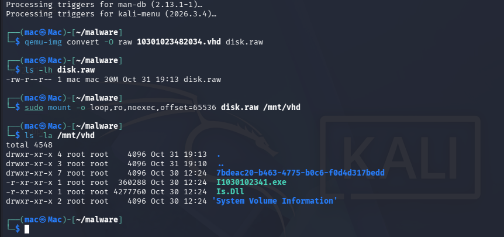
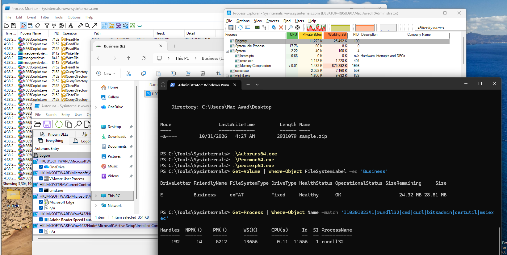
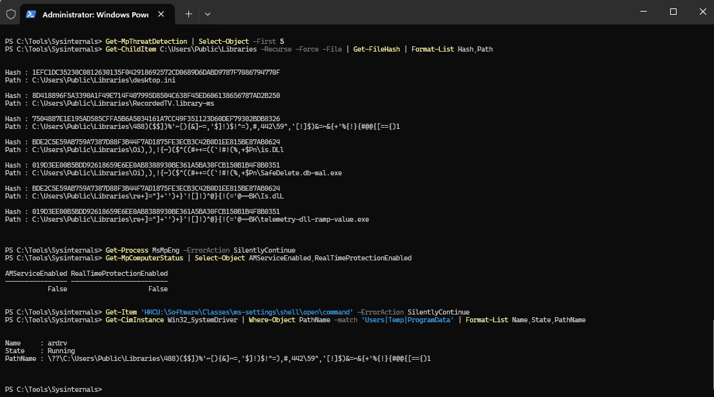
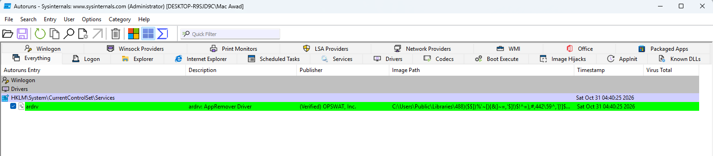
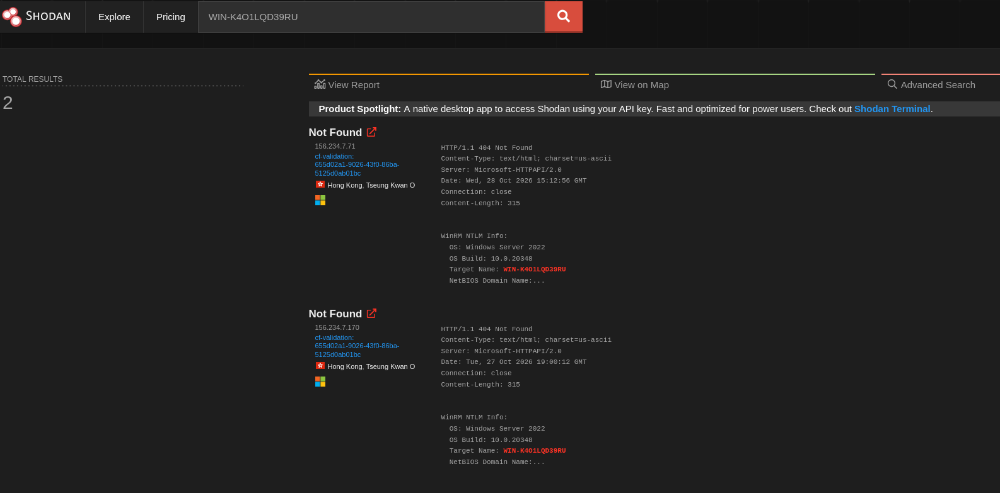
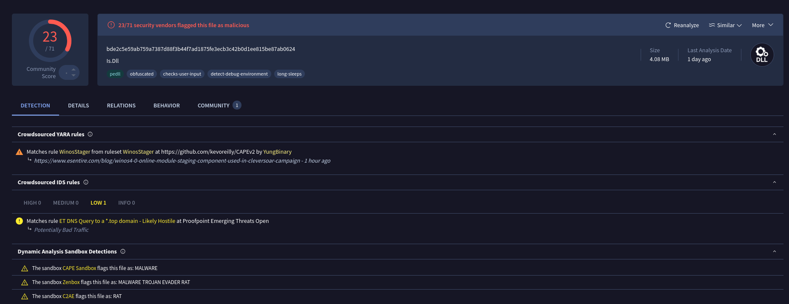

# WhatsApp Malware Analysis: Winos 4.0 / ValleyRAT Stager with a BYOVD AV Killer

**Author:** Mac Awad, Cyber Security student (Certificate IV, TAFE Queensland) · [LinkedIn](https://www.linkedin.com/in/mac-awad-695216125)
**Date:** 30 Oct to 1 Nov 2026 (times in AEST, UTC+10)
**Status:** Reported to ASD's ACSC (ReportCyber), ThreatFox and the domain registrar

> A "payment statement" ZIP sent from a hijacked WhatsApp account turned out to be a Winos 4.0 / ValleyRAT stager. In an isolated lab it killed Microsoft Defender with a signed vulnerable driver, then beaconed to a previously unreported C2 domain over a custom binary protocol on TCP 443. Passive OSINT traced the C2 to a pool of disposable Windows servers in Hong Kong.

## TL;DR

- **Delivery:** WhatsApp message from a hijacked business contact, ZIP > VHD > signed EXE + hidden DLL (DLL sideloading)
- **Defence evasion:** Mark-of-the-Web bypass (VHD), RC4-encrypted strings, UAC bypass, **BYOVD**: OPSWAT `ardrv.sys` (CVE-2026-36425) used to kill Microsoft Defender
- **C2:** `wwwapko[.]top` → `156.234.7[.]71`, raw TCP/443 (not TLS), 16-byte hello, beacon about every 67 s
- **Infrastructure:** domain registered 2 days before the attack; C2 is a fresh Windows Server 2022 box in Hong Kong; its default hostname also appears on `156.234.7[.]170` a day earlier, most likely the same server before an IP change
- **Family:** VirusTotal YARA rules identify it as a **Winos 4.0 / ValleyRAT** stager, a Gh0st RAT descendant attributed to the **Silver Fox** group
- **New intel:** I found no public reports of the C2 domain or IPs and reported them first on ThreatFox

## Attack chain



## 1. Delivery



The message used a classic invoice-fraud script: urgency ("resolve this payment gap"), authority ("forward it to your finance head") and platform steering ("open it on a computer", because the payload only runs on Windows). The account owner sent a spam warning 47 minutes later, confirming the account was hijacked.



## 2. Static analysis

| File | Size | Notes |
| --- | --- | --- |
| `E-statement Proforma Invoice (2).zip` | 2.9 MB | Wrapper |
| `10301023482034.vhd` | 6.3 MB | Dynamic VHD, exFAT, volume label "Business", built 30 Oct 02:24 UTC on a UTC+8 clock |
| `I1030102341.exe` | 360 KB | Genuine Menksoft `SETTINGM.exe` (2017), validly signed; imports 3 functions from `Is.dll` |
| `Is.Dll` | 4.28 MB | Malicious, Hidden + System, compiled 29 Oct 2026 17:03 UTC, export name `MSEdgeWebView.dll` |



Key findings from `Is.Dll`:

- Exports the three functions the host needs, plus a fake `vcruntime140_1_app` used to relaunch itself through rundll32
- A 1.33 MB section with a Chinese name (starting 正在) and entropy 7.49 (packed payload)
- Resources disguised as OneDrive data; three of them (`SETTINGSDATABASE`, `SYNCENGINEDATABASE`, `UXDATABASE`) are encrypted payloads
- Download fallbacks in clear text: `curl -L -s -o`, `bitsadmin /transfer`, `certutil -urlcache`, `msiexec /qn`
- Config strings stored as hex and encrypted with **RC4**, key = the ASCII string `3DC0C2FE338F567442B73E4B644B4F1A`

Decryptor (static, never executes the sample):

```python
import re, sys
key = b'3DC0C2FE338F567442B73E4B644B4F1A'
def rc4(k, d):
    S = list(range(256)); j = 0
    for i in range(256):
        j = (j + S[i] + k[i % len(k)]) % 256; S[i], S[j] = S[j], S[i]
    i = j = 0; out = bytearray()
    for b in d:
        i = (i + 1) % 256; j = (j + S[i]) % 256; S[i], S[j] = S[j], S[i]
        out.append(b ^ S[(S[i] + S[j]) % 256])
    return bytes(out)
data = open(sys.argv[1], 'rb').read()
for m in re.finditer(rb'(?:[0-9A-F]\x00){16,}', data):
    h = m.group().decode('utf-16le')
    if len(h) % 2: continue
    pt = rc4(key, bytes.fromhex(h))
    if sum(32 <= c < 127 for c in pt) > 0.85 * len(pt):
        print(pt.decode()[:150])
```

Decrypted strings revealed:

- Vulnerable driver devices: `\\.\HWAudioX64`, `\\.\ardrv`, `\\.\Alinubx`
- AV kill lists: 227 process names across Defender, CrowdStrike, SentinelOne, Sophos, Kaspersky, ESET, Bitdefender, Trend Micro, K7, 360, AhnLab and more
- UAC bypasses: `HKCU\Software\Classes\ms-settings\shell\open\command` + `ComputerDefaults.exe`, and the CMSTPLUA elevation moniker `{3E5FC7F9-9A51-4367-9063-A120244FBEC7}`
- Staging path: `C:\Users\Public\Libraries\<random>\<random>`

## 3. Dynamic analysis (isolated lab)

**Setup:** Windows 11 VM (Defender on, Sysinternals Procmon, Process Explorer, Autoruns) and a Kali VM as fake internet (INetSim, a small fake DNS script, tcpdump), on a private VMware LAN segment with no real internet. Clean snapshot before each run.

| Time | Observation |
| --- | --- |
| 21:40 | VHD mounts as "Business"; only the EXE is visible; no window appears |
| 21:40 | Kit copied to 3 hidden junk-named folders in `C:\Users\Public\Libraries`, host EXE renamed after OneDrive files (`SafeDelete.db-wal.exe`, `telemetry-dll-ramp-value.exe`, `SyncEngineDatabase.db.exe`) |
| 21:40 | Relaunch: `rundll32.exe "...\IS.dll",vcruntime140_1_app` |
| 21:40:25 | Drops a 17,744-byte driver and creates kernel service `ardrv` (OPSWAT, verified signature) |
| 21:40 | **Defender killed**: `MsMpEng` gone, real-time protection off, no detection logged |
| 21:40:39 | First DNS lookup for `wwwapko[.]top`; 1,080 lookups in under an hour |







The dropped driver's SHA-256 `7504887e...` matches **OPSWAT AppRemover `ardrv.sys`, CVE-2026-36425**: its IOCTL `0x2420031` terminates any process ID from kernel mode. No Run key or scheduled task was created, so persistence would come from the next stage.

## 4. C2 protocol

With a working fake DNS, the malware resolved the domain and connected to TCP 443, but **never started TLS**. It sent a 16-byte binary hello instead:

```
10 00 00 00  2c 4b 0a 00  5d 8e 13 33 fb  00  66 62
```

| Bytes | Meaning |
| --- | --- |
| 0-3 | Length = 16 (little-endian), constant |
| 4-7 | Windows uptime in ms (674,604 = 11.2 min); increases by exactly the wall-clock time between packets |
| 8-12 | Random per packet |
| 13 | Always `00` |
| 14-15 | Check bytes; byte 15 = byte 14 XOR `0x04` |

**Retry pattern:** a new TCP connection every 2.5 s in bursts, and a fresh DNS lookup about every 67 s. This matches a Winos 4.0 stager asking its C2 for the core "online module". The real server was deliberately never contacted.

## 5. Infrastructure (passive OSINT only)

| Item | Finding |
| --- | --- |
| Domain | `wwwapko[.]top`, registered 28 Oct 2026 15:49 UTC via Gname.com, registrant region Hong Kong |
| IP | `156.234.7[.]71`, AFRINIC block assigned to Yancy Limited (HK), AS138415; no abuse contact |
| Server | Windows Server 2022 (build 20348), default hostname `WIN-K4O1LQD39RU`, WinRM 5985 open |
| Earlier IP | `156.234.7[.]170`, same hostname, seen about 20 h before `.71`; most likely the same server before an IP change, or a clone |



**The neighbourhood:** `net:156.234.7.0/24 port:5985` returns 28 WinRM hosts, 24 of them default-named Windows Server 2022. At least 7 hostnames each appear on two IPs a few days apart, so hostname reuse is normal in this block (IP changes or cloned images), not unique to this operator. The block looks like a pool of disposable Windows servers; no other host was linked to this campaign without further evidence.

**Preparation timeline (AEST):** C2 server online 29 Oct 01:12 → domain registered 01:49 → DLL compiled 30 Oct 03:03 → VHD built 12:24 → lure sent 17:34. Under 40 hours from buying the domain to attacking.

## 6. Family and attribution



VirusTotal YARA rules (THOR `MAL_Valley_RAT_Downloader_Nov25`, CAPE `WinosStager`) identify the DLL as a **Winos 4.0 / ValleyRAT** stager, a Gh0st RAT descendant that researchers attribute to **Silver Fox** (also called Void Arachne). The Chinese section name, UTC+8 build clock, Hong Kong registrant and Hong Kong hosting all fit.

**Assessment:** Chinese-speaking operator, **moderate confidence**. Physical location **unknown**: VPNs and rented servers hide it, and build artifacts can be faked or come from a shared toolkit.

## 7. MITRE ATT&CK

| Tactic | Technique |
| --- | --- |
| Initial Access | T1566.003 Spearphishing via Service |
| Execution | T1204.002 Malicious File; T1059.003 Windows Command Shell |
| Defense Evasion | T1553.005 MOTW Bypass; T1574.001 DLL (sideloading); T1564.001 Hidden Files; T1036.005 Match Legitimate Name; T1027 Obfuscated Files; T1218.011 Rundll32; T1218.007 Msiexec; T1562.001 Disable or Modify Tools |
| Privilege Escalation | T1548.002 Bypass UAC; T1068 Exploitation for Privilege Escalation (BYOVD); T1543.003 Windows Service |
| Command and Control | T1095 Non-Application Layer Protocol; T1571 Non-Standard Port; T1105 Ingress Tool Transfer |

## 8. Indicators of compromise

| Type | Value |
| --- | --- |
| SHA-256 (ZIP) | `2d0a9acfec2151d95c51381259a0bf683e3ab728182514ecfdb3027dda921af3` |
| SHA-256 (VHD) | `983d3f194606255480bcbc99365dc2df151c6f3cc05fdb03d2609ad72665b430` |
| SHA-256 (Is.Dll) | `bde2c5e59ab759a7387d88f3b44f7ad1875fe3ecb3c42b0d1ee815be87ab0624` |
| SHA-256 (ardrv.sys) | `7504887e1e195ad585cffa5b6a5034161a7cc49f351123d60def79302bdb8326` |
| SHA-256 (host EXE, legit) | `019d3ee00b5bdd92618659e6ee0ab8388930be361a5ba30fcb150b1b4f8b0351` |
| Domain | `wwwapko[.]top` |
| IP | `156.234.7[.]71`, `156.234.7[.]170` |
| Hostname | `WIN-K4O1LQD39RU` |
| Service | `ardrv` (kernel) |
| Path | `C:\Users\Public\Libraries\<junk>\` |
| Command line | `rundll32.exe "<path>\Is.Dll",vcruntime140_1_app` |

## 9. Detection

```
alert dns $HOME_NET any -> any any (msg:"WhatsApp VHD loader C2 domain lookup"; dns.query; content:"wwwapko.top"; nocase; sid:1000001; rev:1;)
alert tcp $HOME_NET any -> $EXTERNAL_NET 443 (msg:"WhatsApp VHD loader 16-byte C2 hello on 443"; flow:to_server,established; dsize:16; content:"|10 00 00 00|"; offset:0; depth:4; content:"|00|"; offset:13; depth:1; sid:1000002; rev:1;)
```

Hunt for: new kernel services (Event ID 7045) from user folders, `rundll32` with `,vcruntime140_1_app`, new folders in `C:\Users\Public\Libraries`, and non-TLS traffic on port 443. Prevent with HVCI + the vulnerable driver blocklist, standard user accounts, and blocking double-click mounting of VHD/ISO files.

## 10. Disclosure

- ASD's ACSC via ReportCyber (referred to Queensland Police), 31 Oct 2026
- [ThreatFox](https://threatfox.abuse.ch/user/53531/): domain and IP submitted 31 Oct 2026
- [VirusTotal](https://www.virustotal.com/gui/file/bde2c5e59ab759a7387d88f3b44f7ad1875fe3ecb3c42b0d1ee815be87ab0624): analysis comment
- Takedown request to the registrar's abuse team

## Ethics and safety

The sample only ran in an isolated VM with no internet access. The real C2 was never contacted, scanned or logged into; all infrastructure research was passive (whois, DNS, Shodan, VirusTotal). Personal details of the hijacked contact are blurred.

## References

- [Quick Heal: Ongoing WhatsApp-Based Malware Campaign](https://www.quickheal.co.in/knowledge-centre/ongoing-whatsapp-based-malware-campaign/)
- [CVE-2026-36425 OPSWAT AppRemover (ardrv.sys)](https://github.com/redteamfortress/CVE-2026-36425) · [LOLDrivers: ardrv.sys](https://www.loldrivers.io/drivers/9eb0156e-4c43-487f-be8c-40a7b19a4279/)
- [The Hacker News: Silver Fox APT uses Winos 4.0](https://thehackernews.com/2025/02/silver-fox-apt-uses-winos-40-malware-in.html)
- [The Hacker News: Fake installers deliver Winos 4.0](https://thehackernews.com/2025/05/hackers-use-fake-vpn-and-browser-nsis.html)
- [Acronis TRU: Cambodia-focused cluster (same ardrv.sys hash)](https://www.acronis.com/en/tru/posts/cambodia-focused-cluster-uses-multi-stage-infection-chain-with-localized-lures/)
